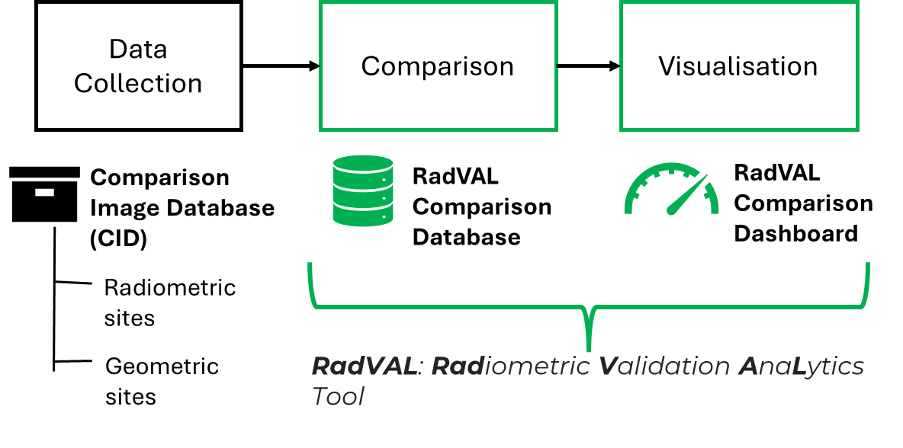
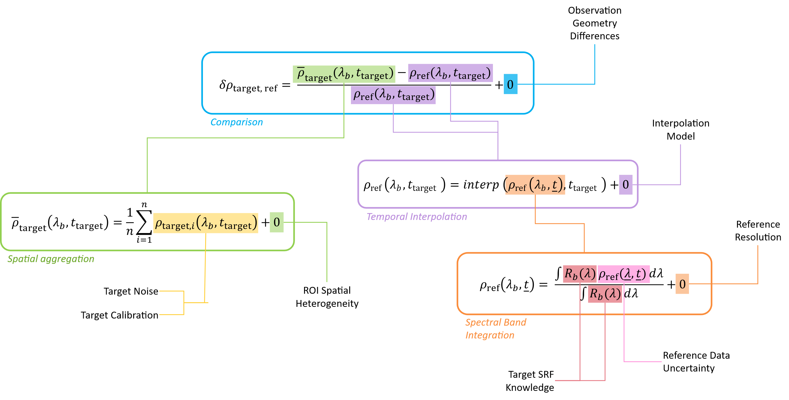
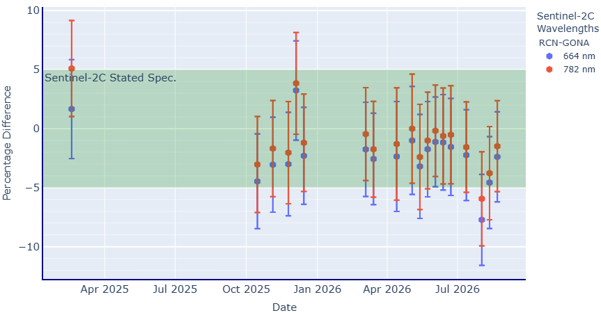

## 📈 Background

The Committee on Earth Observation Satellites (CEOS) Working Group on Calibration and Validation (WGCV) coordinates international activities to assess and improve the quality of Earth observation (EO) satellite measurements. 

Key outcomes of this activity are the **Product Validation Platform (CEOS-PVP)** and the **RadVAL Dashboard**, which provides satellite-to-in-situ validation results and long-term radiometric stability monitoring for EO missions.

The comparison system is implemented using the **NPL MetEOR Toolkit**, which performs matchup processing, uncertainty propagation and statistical analysis.

For a full overview of the CEOS PVP activity, visit:

👉 https://www.ceos-pvp.org/

## ☄️ MetEOR Processing

The RadVAL workflow compares satellite observations with highly characterised reference measurements from ground-based calibration sites.

To create comparable observations, MetEOR performs three key processing steps:

1. **Spectral integration** of hyperspectral reference measurements using the satellite spectral response function.
2. **Temporal interpolation** to the satellite overpass time.
3. **Spatial aggregation** of satellite pixels within the site's region of interest.

The resulting matchup pairs allow the bias between satellite and reference observations to be evaluated for each sensor band and overpass.

A detailed description of the methodology is available at:

👉 https://www.ceos-pvp.org/methods

### ➸ Uncertainty Analysis

Alongside the measurement comparison, MetEOR evaluates uncertainty contributions from the satellite observations, reference measurements and comparison process.

The uncertainty structure used within the RadVAL analysis is summarised below.

Further details are available in the report:

👉 *Multispectral Satellite-to-In-Situ Comparison Uncertainty Budget*  
https://www.ceos-pvp.org/download/multispectral-uncertainty-report

## 📂 Results

The processed comparisons are published through the **RadVAL Dashboard**, where time series of satellite-reference bias can be explored for different sensors, spectral bands and validation sites.

The resulting records provide an indicator of sensor radiometric stability through time:

- Consistent bias indicates stable sensor performance.
- Gradual changes may indicate sensor drift.
- Abrupt changes can reveal calibration updates or instrument anomalies.

The dashboard also displays uncertainty estimates arising from the satellite measurements, reference observations and comparison methodology.

### ➸ Explore the Results

Interactive RadVAL products are available at:

👉 https://www.ceos-pvp.org/radval-dashboard

### ➸ Summary

This case study demonstrates how **MetEOR** enables traceable, uncertainty-aware satellite-to-in-situ radiometric validation within the **CEOS RadVAL** framework.

By combining robust matchup processing with uncertainty analysis, the system supports the monitoring of radiometric stability across Earth observation satellite missions.****