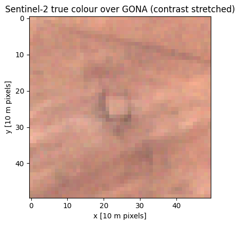
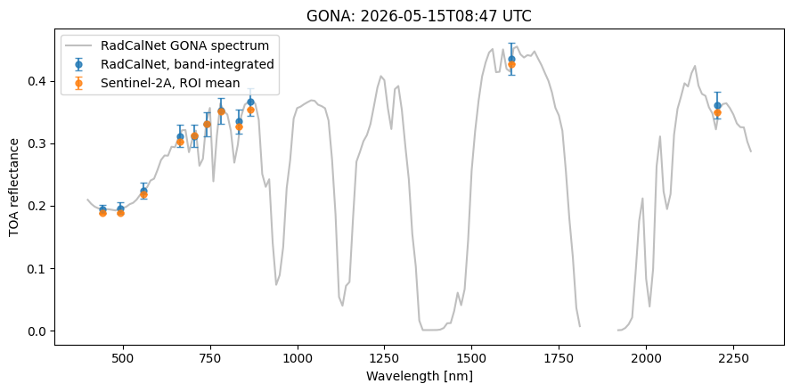
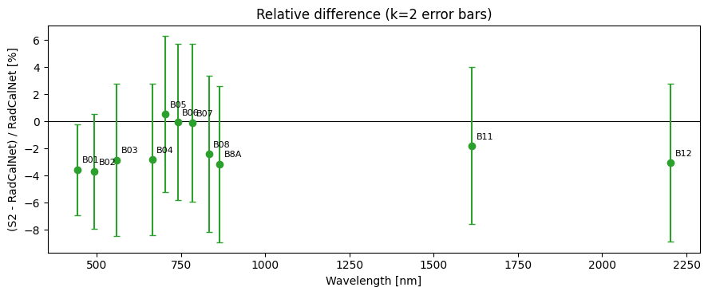

## 🛰️ Background

How can we determine whether a satellite is measuring reflectance accurately?

One approach is to compare satellite observations against trusted ground-based reference measurements. The **MetEOR Toolkit** provides an end-to-end workflow for performing these comparisons while accounting for measurement uncertainty throughout the process.

This example compares **Sentinel-2A Top-of-Atmosphere (TOA) reflectance** with observations from the **RadCalNet Gobabeb site (GONA)** in Namibia during a clear-sky overpass.

📓 **Full worked code example notebook:**

👉 https://github.com/comet-toolkit/comet_training/blob/main/meteor_sat2insitu_example.ipynb

## 🎯 What does the workflow do?

The notebook demonstrates the complete satellite-to-in-situ comparison workflow:

1. **Find satellite overpasses** of a reference site.
2. **Read satellite and reference datasets** together with their uncertainties.
3. **Prepare observations for comparison** by aligning them in space, time and spectral response.
4. **Compare measurements with propagated uncertainties.**

The workflow is designed to scale from a single matchup to large collections of satellite overpasses.

## ☄️ Which MetEOR tools are used?

This example combines several tools from the MetEOR ecosystem:

| Tool | Purpose |
|--------|--------|
| `scrappi` | Discover and download satellite and in-situ data products |
| `eomatch` | Find and catalogue satellite-to-in-situ matchups |
| `eoio` | Read observations, metadata and uncertainties |
| `meteor_maths` | Perform spectral harmonisation and mathematical processing |

Together, these tools create a consistent and traceable comparison pipeline.

## ✓ Step 1: Find a Matchup

The first task is identifying a suitable satellite overpass.

Using **eomatch**, MetEOR searches both satellite and reference archives to identify observations that occur at approximately the same time and location.

For this example:

- Platform: **Sentinel-2A**
- Reference site: **RadCalNet GONA**
- Product type: **Top-of-Atmosphere Reflectance**
- Conditions: **Clear-sky overpass**

The resulting matchup catalogue contains all information required for subsequent analysis.

## ✓ Step 2: Read the Measurements and Uncertainties

After downloading the products, MetEOR reads both datasets into a common structure.

Importantly, the measurements are not read in isolation. Their associated uncertainty information is also preserved.

### ➸ Sentinel-2 Uncertainties

For Sentinel-2, uncertainty estimates are generated using ESA's Sentinel-2 Radiometric Uncertainty Tool. These uncertainties are separated into:

- **Systematic uncertainty** affecting all pixels similarly.
- **Random uncertainty** varying between individual pixels.

### ➸ RadCalNet Uncertainties

RadCalNet provides:

- Spectral reflectance measurements.
- Accompanying uncertainty estimates.

This allows uncertainty propagation to be maintained for both datasets throughout the comparison.

## ✓ Step 3: Prepare the Datasets for Comparison

Before measurements can be compared, they must represent the same spectral, temporal and spatial conditions.

MetEOR performs three key adjustments:

### ➸ Spatial Alignment

Satellite pixels within the site's region of interest are averaged to produce a representative site-scale observation.

### ➸ Spectral Alignment

The RadCalNet hyperspectral measurements are integrated across the **Sentinel-2 spectral response functions**, producing equivalent Sentinel-2 bands.

### ➸ Temporal Alignment

RadCalNet measurements are interpolated to the exact Sentinel-2 acquisition time.

Throughout these processing steps, uncertainty is propagated using the uncertainty metadata stored alongside the observations.

## ✓ Step 4: Compare Satellite and Reference Observations

Once both datasets have been harmonised, they can be compared directly.

The figure below shows:

- The RadCalNet reflectance spectrum.
- The corresponding band-integrated RadCalNet values.
- Sentinel-2 observations for the same overpass.
- Associated uncertainty estimates.

### ➸ How well do they agree?

The final step calculates the relative difference between the satellite and reference measurements for each spectral band.

Uncertainties from the satellite and reference observations are combined to determine whether observed differences are statistically significant.

Bands whose uncertainty intervals include zero can be considered consistent within the stated measurement uncertainties.

## 📂 Results

This example demonstrates how MetEOR can:

- Discover satellite-to-in-situ matchups,
- Read observations together with uncertainty information,
- Harmonise measurements across space, time and spectral response,
- Propagate uncertainty through each processing stage,
- Quantify agreement between satellite and reference observations.

Although the notebook analyses a single Sentinel-2 overpass, the same workflow can be extended to multiple sites, sensors and time periods.

## 📚 Learn More

This page provides a high-level overview of the workflow.

For the complete code, figures and detailed explanations of each processing step, see the full Jupyter Notebook:

👉 https://github.com/comet-toolkit/comet_training/blob/main/meteor_sat2insitu_example.ipynb